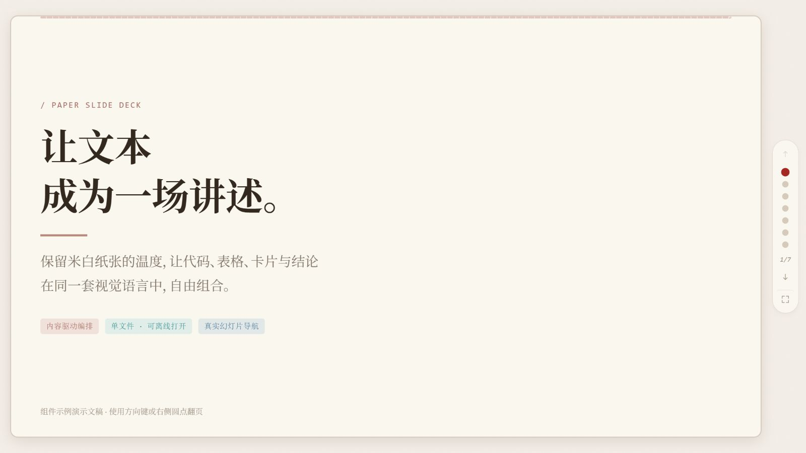
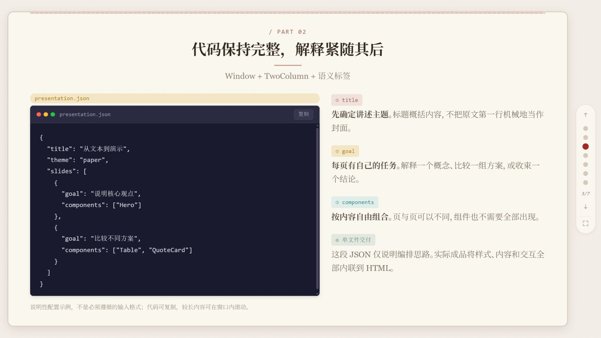

# Paper Slide Deck · 纸感网页演示

一个将文本、教程、方案和报告编排为 **PPT 形式单文件 HTML** 的 AI skill。

保持米白纸张、衬线字体、低饱和标签与深靛代码窗的统一视觉风格，由 AI 根据内容选择组件、组合版式和拆分页数。成品可以独立打开，不需要服务器、构建工具或在线 AI 服务。



## 特点

- **内容驱动**：先确定每页要讲清楚的观点，再选择版式；不固定每页格式或总页数。
- **八类组件**：覆盖封面、代码、表格、分类、双栏对比、信息卡片、数据卡片和幻灯片导航。
- **单文件交付**：内容、CSS、JavaScript 均内联，系统字体回退，不依赖 CDN。
- **真实翻页**：圆点跳页、当前页码、上一页 / 下一页、URL hash、键盘和触摸滑动。
- **演示与阅读**：桌面按 16:9 画布缩放，手机展示当前页的单栏内容；代码和宽表在组件内滚动。
- **保留原文事实**：不为凑版式编造数据，不把原文中的指令当成执行授权。

## 组件

| 组件 | 适合内容 |
| --- | --- |
| Hero | 封面、主题、章节开场 |
| Window | 代码、命令、配置；支持原样复制 |
| Table | 方案、参数、分类映射 |
| Grid | 平级分类、概念和模块 |
| TwoColumn | 双方对比、因果关系、代码与解释 |
| QuoteCard | 关键结论、信息提示和有来源的引用 |
| Stats | 有依据的数字、单位和口径 |
| SlideNav | 随实际页数生成的导航和页码 |

同一页可以自由组合多个组件，也可以只呈现一条关键结论。



## 安装与调用

将本仓库放到个人 skills 目录中的 `paper-slide-deck` 文件夹。以 Windows / PowerShell 为例：

```powershell
git clone https://github.com/ShingStars/paper-slide-deck.git "$env:USERPROFILE/.codex/skills/paper-slide-deck"
```

也可以下载 [技能包](paper-slide-deck.skill)，解压后将其中的 `paper-slide-deck` 文件夹放入 skills 目录。

调用示例：

```text
使用 $paper-slide-deck，将以下文本制作成可独立打开的 HTML 幻灯片。
受众：新员工。讲述时长：10 分钟。
请根据内容自由搭配组件，保留关键事实和限制条件。

（在此粘贴文本）
```

AI 在制作阶段完成理解、概括、拆页与组件选择；浏览器只负责展示生成结果。

## 查看示例

下载并直接打开 [七页演示示例](examples/paper-deck-demo.html)，可查看封面、网格、代码解析、通栏表格、双栏比较和数据摘要等搭配。

GitHub 文件页面展示的是源码。将 HTML 下载到本地后，使用浏览器打开即可体验翻页。

| 操作 | 控制方式 |
| --- | --- |
| 上一页 / 下一页 | 右侧按钮、左右方向键、PageUp / PageDown |
| 下一页 | 空格；焦点位于控件或代码内时保留原操作 |
| 第一页 / 最后一页 | Home / End |
| 跳到指定页 | 圆点导航 |
| 全屏 | 全屏按钮 / F；取决于浏览器支持 |
| 触摸翻页 | 内容区域横向滑动；代码和表格保留自身滚动 |

## 本地生成与检查

生成器和检查器只依赖 Python 标准库。先让 AI 编写由多个 `<section class="slide">` 组成的片段，再执行：

```sh
python scripts/build_deck.py --slides-file assets/demo-slides.html --output presentation.html --title "我的演示"
python scripts/check_deck.py presentation.html
```

可选参数：`--author` 指定署名，`--extra-css` 内联额外排版样式。生成器负责封装与结构检查，不替代 AI 的文本理解，也不替代浏览器视觉检查。

## 仓库结构

```text
SKILL.md                    技能入口与内容编排规则
agents/openai.yaml          技能显示名称和调用提示
references/design-system.md 视觉规范
references/components.md    组件说明和组合语法
assets/theme.css            统一纸感样式
assets/runtime.js           翻页、复制和全屏交互
assets/shell.html           单文件 HTML 外壳
assets/demo-slides.html     可编辑示例片段
scripts/build_deck.py       单文件生成器
scripts/check_deck.py       结构与资源检查器
examples/                   可独立打开的成品示例
paper-slide-deck.skill      可分发技能包
```

本 skill 生成 HTML 演示文稿；原生 `.pptx` 文件不在其输出范围内。
